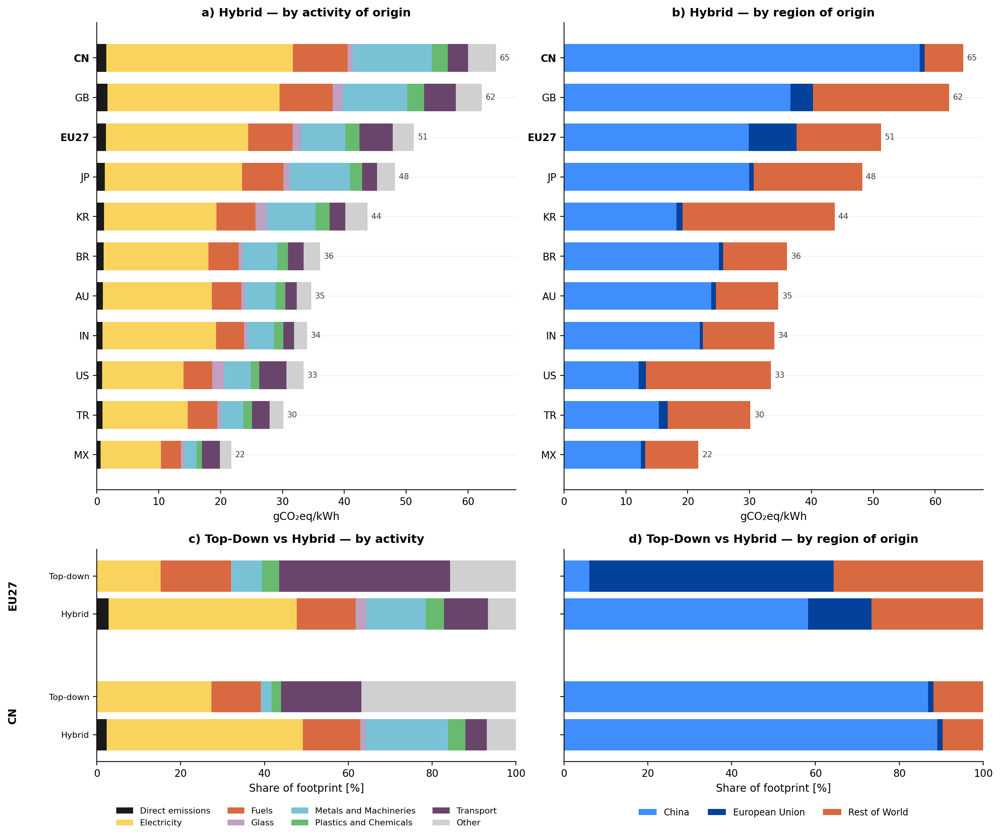

:page-type: Research model
:summary: Assess the environmental and socio-economic effects of moving photovoltaic supply chains to Europe.

Solar PV reshoring
==================

Lorenzo Rinaldi, Raffaele Merletti, Camilla Citterio, Nicolò Golinucci, Matteo Vincenzo Rocco (2026). `Environmental and socio-economic implications of solar photovoltaic reshoring under the EU Net Zero Industry Act: a hybrid input-output assessment <https://doi.org/10.1007/s44498-026-00175-0>`__. *Journal of Industrial Ecology*.

Assess the environmental and socio-economic effects of moving photovoltaic supply chains to Europe.

Model and scope
---------------

Embeds an explicit photovoltaic supply chain in a hybrid supply-use model and varies sourcing, technology and performance assumptions.

Carbon footprints, prices, production, value added and employment; reshoring scenarios and parameter sensitivity.

Database
--------

Builds on the Green steel modelling line, then adapts the database and regional aggregation for PV. This is a study-specific extension, not a replacement release of the steel database.

:doc:`Database lineage <databases>`

PV reconstruction results
-------------------------

   PV electricity footprints in g CO2eq/kWh, decomposed by activity and region of origin (top), and the relative contributions in the hybrid and top-down calculations (bottom). Figure 3 from the recorded PV repository revision; these are existing reconstruction outputs, not a new gallery execution.

`Original figure <https://raw.githubusercontent.com/it-is-me-mario/pv-hlca-model/28a444dfb966887534ec6963dd3db8b7f5fee6b4/outputs/figures/Figure3.png>`__

Available editions
------------------

Archived PV release · 1.0.1
~~~~~~~~~~~~~~~~~~~~~~~~~~~

Fixed archive linked to the PV study.

`Code and instructions <https://github.com/it-is-me-mario/pv-hlca-model/blob/70c7d5a6fe52a44c88b4df1a7c74137f9e7bf75b/README.md>`__ · `Recorded revision 70c7d5a6 <https://github.com/it-is-me-mario/pv-hlca-model/tree/70c7d5a6fe52a44c88b4df1a7c74137f9e7bf75b>`__

* `PV code and data archive · v1.0.1 <https://zenodo.org/records/20734983>`__

Use the archived environment and inputs when comparing this edition with the paper.

Documented reconstruction
~~~~~~~~~~~~~~~~~~~~~~~~~

Notebook, command-line pipeline, scenario configuration and baseline comparison.

`Code and instructions <https://github.com/it-is-me-mario/pv-hlca-model/blob/28a444dfb966887534ec6963dd3db8b7f5fee6b4/notebooks/PV_HLCA_pipeline.ipynb>`__ · `Recorded revision 28a444df <https://github.com/it-is-me-mario/pv-hlca-model/tree/28a444dfb966887534ec6963dd3db8b7f5fee6b4>`__

MARIO version: **1.0.0**.

* `Green steel background · v1.3.2 <https://zenodo.org/records/18744457>`__

The repository states that rebuilding from the downloadable background is not bit-identical to the original results. Use its reference outputs and stated tolerances.

* `Reconstruction and validation instructions <https://github.com/it-is-me-mario/pv-hlca-model/blob/28a444dfb966887534ec6963dd3db8b7f5fee6b4/README.md>`__

Related studies
---------------

* :doc:`EU steel decarbonisation <steel-transition-eu>`
* :doc:`GCAM–MARIO steel scenarios <gcam-mario-steel>`

Source review: 2026-11-16. Models have not been rerun by the gallery. Execution evidence linked above belongs to the source maintainers.

:doc:`All models <index>`
