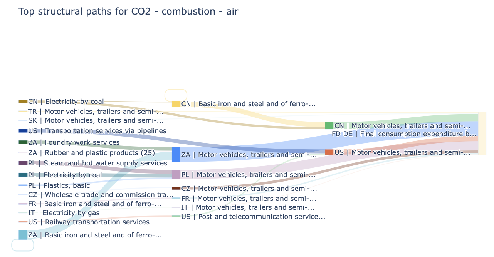

:page-type: Worked example
:summary: An EXIOBASE case study of CO2 paths serving German final demand for motor vehicles.

Trace motor-vehicle supply chains
=================================

.. container:: mario-companion

   :download:`Run the notebook <structural_path_analysis.ipynb>`

.. container:: mario-guide-facts

   **Input** · EXIOBASE 3.10.1, product-by-product IOT, 2022, with emissions.
   **Question** · Which production paths contribute to the selected German
   final-demand bundle's combustion CO2 footprint?

   Example output from the companion notebook. Only retained paths are shown;
   the plot is not the complete footprint.

Follow the analysis
-------------------

.. mario-steps::

   .. mario-step:: 1 · Select demand

      Parse ``IOT_2022_pxp.zip``. Select ``Motor vehicles, trailers and
      semi-trailers (34)`` and rank its German final-demand categories.
      The notebook chooses the largest non-zero bundle.

   .. mario-step:: 2 · Set the threshold

      Calculate the bundle's total footprint first. The example sets the
      pruning threshold to 0.1% of its absolute value and explores at most
      ten upstream rounds.

   .. mario-step:: 3 · Trace and inspect

      .. code-block:: python

         spa = db.calc_spa(
             indicator="CO2 - combustion - air",
             item=SECTOR, final_demand_region=FOCUS_REGION,
             final_demand_category=FOCUS_CATEGORY,
             max_depth=10, cutoff=CUTOFF, top_n=20,
             plot="sankey", show_plot=True,
         )
         spa.attrs["coverage_share"]

      The notebook defines the selectors and ``CUTOFF`` in the preceding steps.
      Compare reported contribution with the full bundle total.

.. mario-details:: Compare paths with the depth summary

   Repeat with ``top_n=None`` and ``plot="depth"`` to group retained
   contributions by upstream round. This removes the returned-row cap, but
   depth and pruning limits still apply.

For a small runnable example, output definitions and limitations, start with
:doc:`Structural path analysis <../analysis/structural_paths>`.
