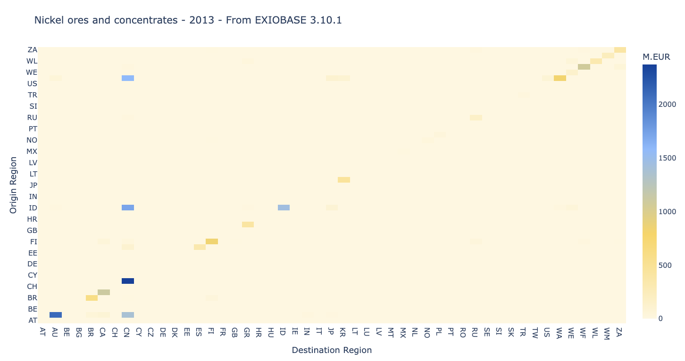

:page-type: Worked example
:summary: Connect trade, embodied content and regional dependencies across two EXIOBASE years.

Trace a nickel supply chain
===========================

.. container:: mario-companion

   :download:`Download notebook <supply_chain_analyses.ipynb>`

.. container:: mario-guide-facts

   **Inputs** · EXIOBASE monetary product-by-product archives for 2013 and 2014.
   **Item** · Nickel ores and concentrates.
   **Outputs** · Trade matrices, embodied value added and CO2, concentration
   and exposure indicators.

   Bilateral trade in the example's first year. Domestic flows are part of
   the returned trade matrix.

Analysis steps
--------------

.. mario-steps::

   .. mario-step:: 1 · Align years

      Parse 2013, rename its baseline to ``"2013"``, and import 2014 as a
      second scenario. Keep the same native classification across both.

   .. mario-step:: 2 · Locate trade

      .. code-block:: python

         trade = db.calc_trades(
             item="Nickel ores and concentrates", scenario="2013",
             aggregate=False, total=True,
         )

      Separate intermediate and final transactions, then compare years or
      group origin regions into continents.

   .. mario-step:: 3 · Attribute impacts

      .. code-block:: python

         content = db.calc_trades_content(
             indicator="total value added",
             item="Nickel ores and concentrates", scenario="2013",
             method="upstream", breakdown=True,
         )

      The contributor breakdown identifies production behind each trade pair,
      beyond the observed exporter.

   .. mario-step:: 4 · Measure dependence

      Compare concentration across contributors with exposure to a chosen
      group of regions. Repeat for an available satellite account such as
      ``CO2 - combustion - air``.

**Interpretation:** concentrated supply and high exposure answer different
questions. Neither measures the absolute size of a flow. Signed indicators
need additional care because shares can involve cancellation.

Method definitions and a runnable small example:
:doc:`Trade and supply-chain analysis <../analysis/supply_chains>`.
